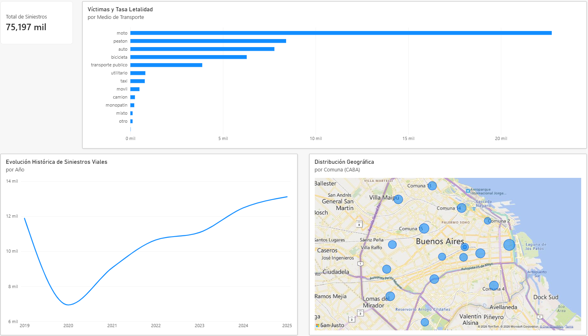

#  Análisis de Siniestralidad Vial y Letalidad en CABA

##  Descripción del Proyecto
Este proyecto presenta un análisis integral de los siniestros viales registrados en la Ciudad Autónoma de Buenos Aires (CABA). Su objetivo principal es evaluar la severidad de los incidentes según el modo de desplazamiento, la demografía de las víctimas y la distribución geográfica por comunas, aportando una perspectiva analítica basada en datos públicos abiertos.

---

##  Tecnologías y Herramientas Utilizadas
* **Lenguaje de Programación:** Python (Pandas para procesamiento y limpieza).
* **Ingeniería de Datos:** Modelado Relacional (Star Schema) y base de datos SQLite (`siniestros.db`).
* **Consultas Analíticas:** SQL (JOINs, agregaciones, filtrado avanzado).
* **Business Intelligence:** Power BI Desktop (Dashboard interactivo y medidas DAX).
* **Control de Versiones:** Git / GitHub.

---

##  Arquitectura del Proyecto y Proceso (ETL)

El ciclo de vida de los datos se desarrolló en tres etapas clave:

1. **Extracción y Transformación (Python / Pandas - `limpieza.py`):**
   * Normalización de nombres de columnas y estandarización de variables categóricas (minúsculas y eliminación de espacios).
   * Conversión de campos de fecha a tipo `datetime` y limpieza de tipos numéricos en edades (`edad_victima`).
   * Filtrado y tratamiento de valores nulos y registros sin datos (`"sd"`).

2. **Modelado Relacional (Star Schema - `ingenieria.py`):**
   * **Tabla de Hechos (`fact_victimas`):** Contiene el detalle transaccional de los incidentes, fechas, edades y gravedad.
   * **Tabla Dimensión (`dim_vehiculos`):** Catálogo normalizado de modos de desplazamiento unificados mediante clave foránea (`id_vehiculo`).
   * Almacenamiento estructurado en una base de datos local SQLite y exportación en CSVs optimizados para BI.

3. **Visualización y Análisis (Power BI):**
   * Creación de medidas personalizadas en **DAX** para el cálculo dinámico de la **Tasa de Letalidad**:
     $$\text{Tasa de Letalidad} = \frac{\text{Víctimas Fatales}}{\text{Total de Siniestros}}$$
   * Integración de mapas geográficos con geolocalización por comunas de CABA y jerarquías temporales.

---

##  Hallazgos Principales

* **Vulnerabilidad Vial:** Aunque las motos concentran el mayor volumen bruto de siniestros viales en la ciudad, los **peatones** experimentan la **tasa de letalidad más alta** debido a la falta de protección física ante impactos.
* **Impacto Histórico (Pandemia):** El análisis temporal refleja una caída abrupta y significativa en la siniestralidad durante el año 2020 a raíz de las restricciones de circulación, con un posterior repunte progresivo.
* **Distribución Espacial:** Concentración crítica de eventos en comunas con alto flujo vehicular y autopistas de la red urbana.

---

##  Vista Previa del Dashboard

